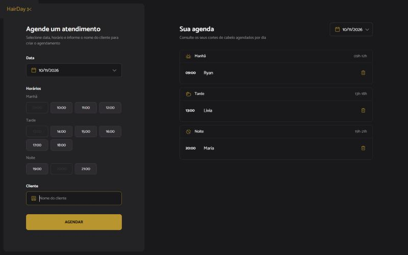
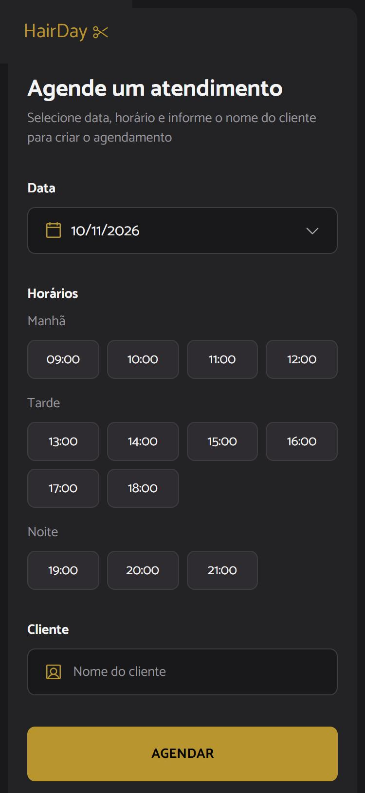

# HairDay

Aplicação de agendamentos para salão/barbearia, baseada no Figma do projeto. Cadastre atendimentos (data, horário e cliente) e consulte a agenda do dia agrupada em Manhã, Tarde e Noite.

## Tecnologias
React 19, Vite, TypeScript, CSS puro e Phosphor Icons. Os dados ficam em memória (estado do React).

## Como executar
```bash
npm install
npm run dev
```
Outros scripts: `npm run build` e `npm run lint`.

## Funcionalidades
- Cadastro com validação (nome, data e horário obrigatórios).
- Horários já ocupados na data ficam desabilitados.
- Agenda por data, agrupada por período e em ordem cronológica.
- Exclusão por `id` e mensagem de estado vazio por período.
- Layout responsivo (desktop e mobile).

## Estrutura
`src/components` (ScheduleSidebar, AppointmentForm, TimeSlots, DateField, AppointmentList, PeriodSection, AppointmentItem, Logo), `src/types`, `src/constants`, `src/utils`. Regras do agente em [AGENTS.md](AGENTS.md).

## Como funciona
- `App` guarda `appointments` com `useState`. Adicionar cria um novo array (`[...current, novo]`); excluir usa `filter` pelo `id`.
- `groupByPeriod` usa `filter()` (data), `reduce()` (período) e a lista renderiza com `map()`.

## Capturas de tela
 

## Evidências MCP
- Context7 MCP: consulta da documentação de `useState` e `Array.prototype.reduce` em [docs/evidence/context7.md](docs/evidence/context7.md).
- Playwright MCP: roteiro de testes e capturas em [docs/evidence/playwright.md](docs/evidence/playwright.md).

## Testes
Validados manualmente no navegador (cadastro, validação, exclusão, troca de data, estados vazios, mobile, console sem erros).
